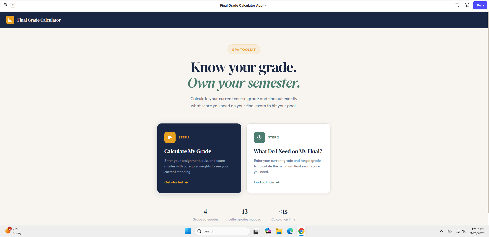
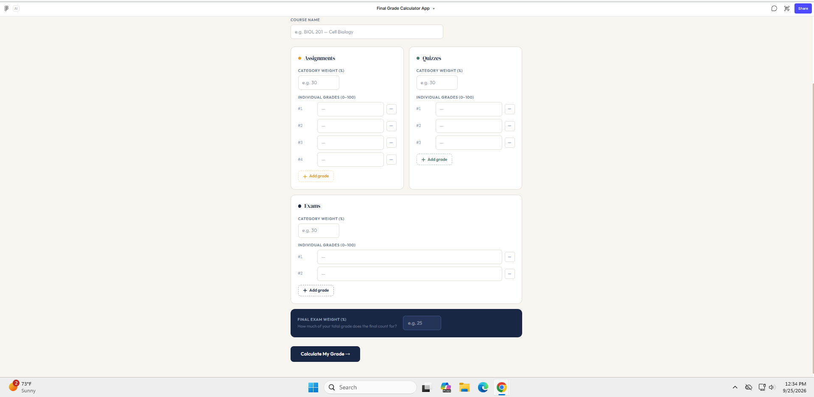
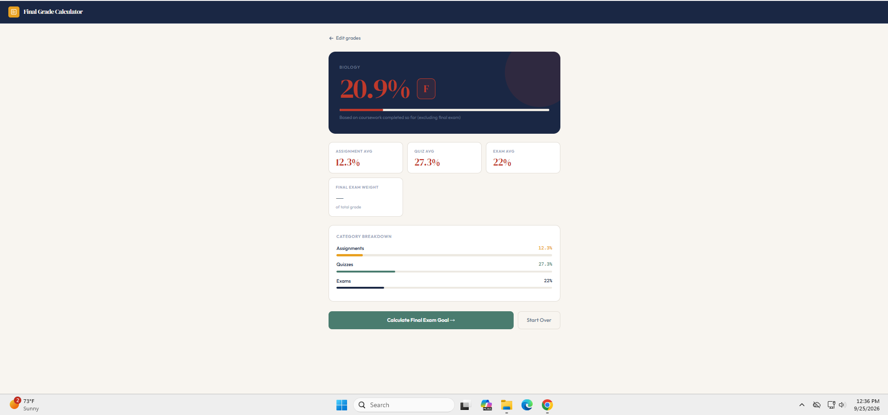

# Fall26_G4
# CSCI 4221 - Final Grade Calculator

## Group 4

**Team Members:**
- Jalen Davis
- Malachi Johnson

## Product Overview

The Final Grade Calculator is a software product designed to help students calculate and understand their grades in a course. The application allows students to enter their grades and course information and receive calculated results.

The goal is to make grade calculations easier and reduce the need for students to manually calculate weighted grades.

## Product Vision

Our vision is to create a simple and user-friendly Final Grade Calculator that helps students understand their current academic performance and determine how future assignments or exams may affect their final grade.

The calculator aims to provide clear results while keeping the process of entering and calculating grades simple.

## Target Users

The primary users of the Final Grade Calculator are college students who want to:

- Calculate their current course grade.
- Track their academic performance.
- Understand how assignment grades affect their overall grade.
- Determine what scores they may need on future assignments or exams.
- Calculate weighted grades without performing the calculations manually.

## Main Features

- Grade input
- Weighted grade calculations
- Course category weights
- Current grade calculation
- Final grade calculation
- Final exam grade calculation
- Clear presentation of calculated results
- Easy-to-use interface

## Project 3: Features, Personas, Scenarios, and User Stories

Project 3 expands the product requirements by identifying the application's key features, intended user personas, usage scenarios, and user stories. These requirements help the team understand what the application should do and how it should support students.

### Section 1: Features

**Feature 1: Calculate Current Course Grade**

The application allows students to enter their course grades and calculate their current overall grade to understand their academic performance.

**Feature 2: Calculate Required Final Exam Score**

The application allows students to enter their current grade, final exam weight, and desired overall grade to determine the exam score needed to reach their goal.

**Feature 3: Estimate Final Course Grade**

The application allows students to enter a possible final exam score and estimate how that score could affect their overall course grade.

### Section 2: Personas

**Persona 1: Student Tracking Current Performance**

Alex Johnson is a college student who wants to monitor academic performance throughout the semester. Alex uses the calculator to check current grades and determine whether improvement is needed.

**Persona 2: Student Preparing for a Final Exam**

Taylor Smith is a student preparing for final exams. Taylor wants to determine the score needed on a final exam to achieve a desired overall course grade.

**Persona 3: Student Comparing Possible Outcomes**

Morgan Lee is a student who wants to compare possible final exam scores to understand how different results could affect the final course grade.

### Section 3: Scenarios

**Scenario 1: Checking a Current Grade**

A student enters their course grades and relevant grading information. The application calculates and displays the current course grade so the student can understand their academic standing.

**Scenario 2: Finding a Required Final Exam Score**

A student wants to achieve a target overall grade. They enter their current grade, the final exam weight, and their target grade. The application calculates the final exam score needed to reach that target, based on the entered information.

**Scenario 3: Estimating a Final Course Grade**

A student wants to understand how different final exam scores could affect their overall grade. They enter a possible exam score, review the estimated result, and repeat the calculation to compare outcomes.

### Section 4: User Stories

**User Story 1: View Current Course Grade**

As a college student, I want to enter my course grades and calculate my current grade so that I can understand my academic performance.

Acceptance criteria:
- The user can enter the grade information supported by the application.
- The application calculates the current grade using the entered information.
- The calculated result is displayed clearly.

**User Story 2: Calculate Required Final Exam Score**

As a student preparing for a final exam, I want to calculate the score I need on the final exam so that I can work toward my desired course grade.

Acceptance criteria:
- The user can enter their current grade, final exam weight, and target overall grade.
- The application calculates the required exam score when the inputs are valid.
- The result indicates when the target cannot be reached under the entered grading conditions.

**User Story 3: Estimate Final Course Grade**

As a student comparing possible outcomes, I want to enter a possible final exam score and estimate my overall grade so that I can compare different outcomes.

Acceptance criteria:
- The user can enter a possible final exam score.
- The application displays the estimated overall course grade.
- The user can repeat the calculation with different scores.

## Team Responsibilities

The following are proposed Project 3 assignments. The team should confirm these assignments and update them to reflect its actual decisions.

| Team Member | Feature | Persona | Scenario | User Story |
|---|---|---|---|---|
| Jalen Davis | Calculate Current Course Grade | Student Tracking Current Performance | Checking a Current Grade | View Current Course Grade |
| Malachi Johnson | Calculate Required Final Exam Score | Student Preparing for a Final Exam | Finding a Required Final Exam Score | Calculate Required Final Exam Score |

The team should assign the third feature, persona, scenario, and user story to a team member and confirm that every member has one of each required assignment.

## Prototype

The Project 2 prototype was created using Figma.

### Main Screen

The main screen provides the starting point for the Final Grade Calculator.



### Grade Input Screen

The grade input screen allows users to enter their grades and course information.



### Results Screen

The results screen displays the calculated grade.



## Figma Prototype

[Final Grade Calculator Figma Prototype](https://www.figma.com/make/ej4oPIRWa1G9tV4l6qxN8Z/Final-Grade-Calculator-App?t=VzNO4h9GoaY0lqrL-1)

## User Flow

1. The student opens the Final Grade Calculator.
2. The student begins a grade calculation.
3. The student enters the required course and grade information.
4. The calculator processes the information.
5. The calculated grade is displayed.
6. The student can change the information and calculate again if necessary.

## Technologies

- Java
- Visual Studio Code
- Git
- GitHub
- Figma

## Project Goals

- Create an easy-to-use grade calculator.
- Make weighted grade calculations easier for students.
- Provide clear and understandable results.
- Develop a functional and user-friendly prototype.
- Identify and document features, personas, scenarios, and user stories.
- Follow the Scrum development process.
- Collaborate as a team to complete project tasks.

## Scrum Team

### Jalen Davis

- Team member
- Prototype development
- Documentation
- Product development

### Malachi Johnson

- Team member
- Prototype development
- Design review
- Documentation

## Project 2 Work

Project 2 focused on product vision and prototyping. The team developed the product vision, identified the intended users, discussed user interactions, created the prototype, and documented the development process through Scrum meeting minutes.

## Project 3 Work

Project 3 focuses on defining the application's requirements through features, personas, scenarios, and user stories. The team identifies the needs of different users, describes situations in which the application will be used, and documents the tasks required to support those needs.

The team should also maintain meeting minutes, discuss the product backlog, assign responsibilities, and update the status of tasks during subsequent meetings.

### Project Documentation

- `Project3.md` - Detailed Project 3 features, personas, scenarios, user stories, responsibilities, and backlog.
- `minutes_1.md` - First meeting minutes.
- `minutes_2.md` - Second meeting minutes.
- `minutes_3.md` - Third meeting minutes.

Meeting minutes should accurately document the team's actual meetings, decisions, assigned tasks, and progress.

## Repository Structure

```text
Fall26_G4/
│
├── README.md
├── Project3.md
├── minutes_1.md
├── minutes_2.md
├── minutes_3.md
│
└── prototype/
    ├── prototype-description.md
    ├── gradeinputsreen
    ├── MainScreen.png
    └── Results
```

*Note: Update the repository structure above if your actual files or folders have different names or locations.*
